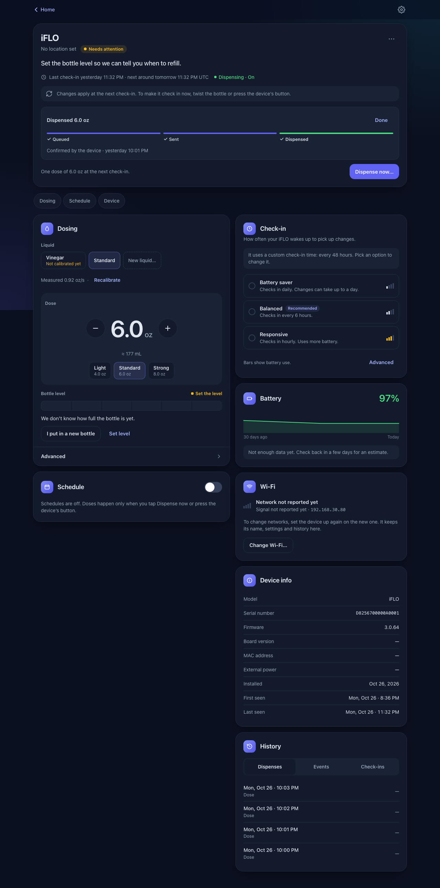
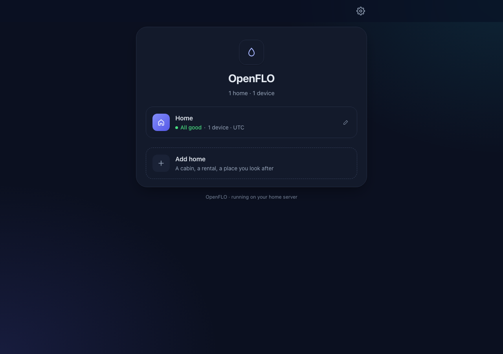
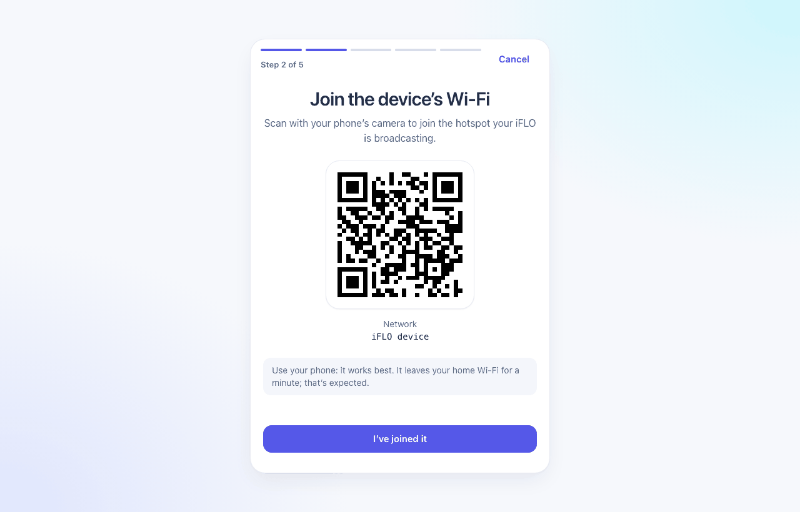
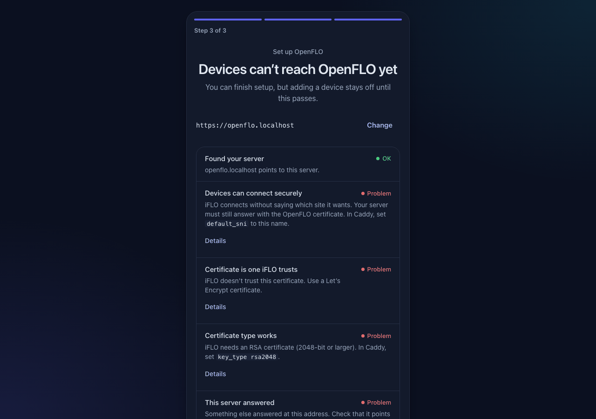

# OpenFLO

OpenFLO is a self-hosted server for iFLO HVAC drain-line dispensers running stock firmware 3.0.64. It replaces the vendor cloud, so you control how much your dispensers dose, and when, from your own server.

It is for homelab owners who run Docker and can point a DNS name at their server.



| Your homes | Adding a device | Checking the server address |
|---|---|---|
|  |  |  |

## What it does

- **Homes and devices.** Group dispensers by home. Each device shows its last and next check-in, battery trend, Wi-Fi and hardware details.
- **Your own liquid, in your own bottle.** Refill the original cartridge with the liquid you choose. OpenFLO authorizes the bottle itself, so there are no replacement cartridges to buy. See [Refilling the cartridge](#refilling-the-cartridge).
- **Dosing by volume.** Set the dose in mL or oz. Pick a liquid (the standard cartridge fluid, vinegar, or your own), calibrate it with one test dispense, and see how full the bottle is and when to refill.
- **Dispense now.** Queue one dose for the next check-in. Dispensing stays off until you turn it on.
- **Schedules.** Dose on the days and times you choose.
- **Check-in presets.** Choose how often the device wakes up: Battery saver, Balanced or Responsive.
- **Honest status.** The device sleeps and can't be reached on demand. Every change shows *Waiting for device* with the expected check-in time until the device picks it up.
- **Add devices with a phone.** A wizard walks you through the device's hotspot and setup page. No terminal and no config files.
- **Sign-in your way.** A single admin account, OIDC (for example Authentik), or an auth proxy. API tokens for scripts.
- **Backups.** A one-line backup and restore, plus an optional daily backup.

## Compatibility

| | |
|---|---|
| Firmware | iFLO **3.0.64** (stock). Other versions are untested. |
| Hardware | Valve units are verified. Other iFLO hardware is unverified. |
| Server | Any Linux host (x86-64 or ARM64) with Docker Compose v2. |
| Port | Devices are verified on port **443** only. |

OpenFLO never changes the device firmware.

## Refilling the cartridge

The original iFLO cartridge can be refilled. No cutting, drilling, or new parts are needed.

1. **Remove the cartridge** from the device.
2. **Pull the top assembly straight out** of the bottle's neck. This is the white cap with the dispensing part and the long dip tube attached. It is a ribbed press fit with no glue, so it comes out by hand, without tools, twisting or prying.
3. **Fill the bottle** with your liquid.
4. **Push the top assembly back in** until it seats fully, then reinstall the cartridge.
5. **In OpenFLO, tap _I put in a new bottle_** and pick the liquid. For a liquid OpenFLO doesn't know yet, choose **New liquid…** and calibrate it: run one dose into a measuring cup and enter what came out. The dose and the bottle level are then right for that liquid.

Why this works: the device only detects that a bottle is present (a physical switch). It does not check which cartridge it is. Whether a bottle may dispense is decided by the server, and with OpenFLO that's your server.

**Before you rely on it:**

- **Seal and leaks.** Refilling and reseating work, but nobody has tested how well the seal holds up over many refills. Check for drips after reinstalling, and replace the cartridge if the fit gets loose.
- **Liquid compatibility.** Use a liquid made or approved for condensate drain lines, such as the original fluid or plain white vinegar. Some liquids can damage the cartridge, the valve, the drain line, or your equipment. Check your HVAC manufacturer's guidance.
- **Never mix chemicals.** Rinse the bottle when you change liquids. Mixing some cleaners, for example bleach with vinegar or ammonia, releases toxic gas.
- **Your responsibility.** Refilling and using other liquids is at your own risk and may affect the manufacturer's warranty.

## Quick start

You need Docker, a DNS name you control, and port 443 reachable by your devices. Read [docs/deploy.md](docs/deploy.md) first if you use Cloudflare or can't open port 80.

```bash
git clone https://github.com/mitchboulay/OpenFlo.git openflo && cd openflo
cp .env.example .env
# Edit .env: set OPENFLO_DOMAIN, OPENFLO_ACME_EMAIL and OPENFLO_PUBLIC_URL.
docker compose up -d
```

Then open `https://<your domain>`. The setup wizard asks you to:

1. create the admin account;
2. confirm the server address your devices will use;
3. check that address the way a device connects.

When the check is green, choose a home and select **Add device**.

## Documentation

- [Deploying](docs/deploy.md): DNS, ports, certificates, LAN-only use, upgrades, backups and troubleshooting.
- [Sign-in](docs/auth.md): basic, OIDC (Authentik), auth proxy and API tokens.
- [Adding devices](docs/provisioning.md): the wizard, resets, moving networks and unclaimed devices.
- [Security model](docs/security-model.md): what device identity can and can't prove.
- [Lab VLAN example](docs/lab-vlan.md): an optional setup for researchers.
- [Changelog](CHANGELOG.md)

## Project

- [Security policy](SECURITY.md): please report vulnerabilities privately.
- [Contributing](CONTRIBUTING.md): read the device-path safety rules first.
- [License](LICENSE): Apache License 2.0.

OpenFLO is an independent project. It is not affiliated with or endorsed by the maker of iFLO. iFLO and other trademarks belong to their owners.
