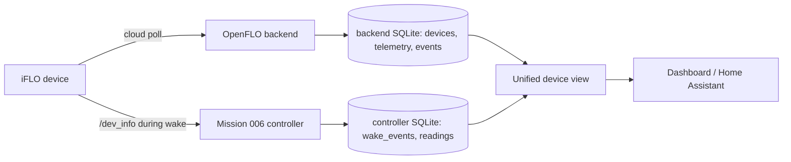

# Controller ↔ backend integration

Date: 2026-10-26. Status: design. Mission 006 live telemetry validation is still
pending and is not assumed to have passed.

## 1. What exists

`controller/app.py`:

- passive wake detection via `tcpdump` on the lab interface;
- `GET /dev_info` polling during wake windows;
- SQLite `wake_events` and `readings`;
- FastAPI dashboard on localhost.

The backend emulator:

- receives cloud telemetry at `/device-api/v2/update-device`;
- stores devices, telemetry, events, QC reports, sync state and protocol logs;
- never emits remote dispense or OTA.

## 2. Unified architecture

Principles:

1. **One device identity.** Use `device_id` as the canonical key; map the
   controller's MAC/DHCP identity to the same `device_id` when available.
2. **No duplicate writes.** Cloud telemetry is written by the backend; local
   `/dev_info` readings are written by the controller. Do not copy one into the
   other as if it were the same observation.
3. **One merged view, two sources.** A view/table joins both by `device_id` and
   `observed_at`, retaining `source=cloud|local`.
4. **Freshness is explicit.** Every row has `observed_at`; the UI marks data
   stale if older than the expected wake interval (default: 2× the observed
   median wake interval, or a conservative 6 h until measured).
5. **Sleep is represented.** Controller `wake_events` is authoritative for
   awake/asleep. Backend `last_seen` is only "last cloud contact".
6. **History remains queryable.** Backend telemetry/events and controller
   readings are retained independently.

## 3. Recommended interface

Option A (least code): the controller reads the backend SQLite database
read-only for cloud devices/telemetry and writes only its own tables. This is
safe on the same host but couples schemas.

Option B (clean): add an internal read-only API to the backend
(`/internal/v1/devices`, `/internal/v1/telemetry`) bound to localhost; the
controller polls it and writes a small `cloud_observations` table. This avoids
shared-schema coupling.

Recommendation: **Option B** for the eventual controller, but do not implement
it until Mission 008 proves the backend path. For Mission 007, the emulator's
SQLite schema is the canonical cloud store.

## 4. Data freshness and sleep

| Signal | Source | Use |
|---|---|---|
| `last_seen` | backend devices | last cloud poll |
| `wake_events` | controller | awake/asleep state |
| `dev_info` | controller | local telemetry supplement |
| `update-device` | backend | cloud telemetry and sync state |
| `protocol_logs` | backend | request/response timing and errors |

A device can be awake with no cloud poll (local-only) or poll the cloud without
the controller seeing it (if the controller capture is down). The UI must show
which source is stale rather than picking one silently.

## 5. Home Assistant integration

- Prefer the backend as the cloud-state source for cloud telemetry and sync
  state.
- Use the controller for local `/dev_info` and sleep/wake state.
- Expose a single merged device entity with attributes:
  `source`, `observed_at`, `stale`, `awake`, `last_cloud_contact`.
- Do not expose control entities that could dispense unless a later mission
  explicitly enables them; the emulator has no remote-dispense path.

## 6. Mission 006 status

Mission 006's live telemetry validation is **pending**. This design does not
depend on it; it only defines how the two sources merge once the controller has
captured at least one wake.
